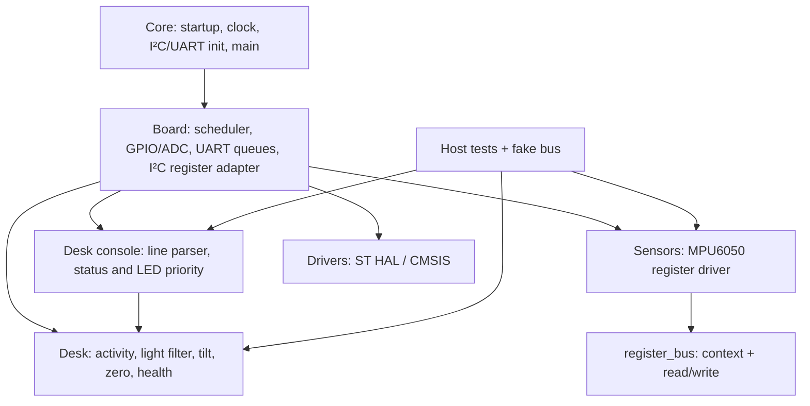

# Архітектура DeskLight

## Компоненти

Desk та Sensors не включають один одного і не знають HAL. Board перетворює imu_sample на вектор прискорення для desk_imu. Контракт register_bus містить context і callbacks з 7-бітною адресою; Board формує адресне поле CR2. Той самий драйвер виконується з fake transport у host tests.

Core містить наявні функції CubeMX та startup. main викликає board_begin і board_step лише в USER CODE. Board зосереджує піни в board.h, хендл ADC, доступ до I²C і USART та інтеграцію. ADC init належить Board, а його параметри також записані в .ioc. Перед регенерацією треба зберегти Board/Desk/Sensors та перевірити Makefile і .ioc.

tools/check_project.py перевіряє локальні включення переносимих шарів, забороняє hardware symbols та звіряє основні з'єднання diagram.json з .ioc. Host compilation не отримує include paths HAL. Перевірка включень не є повним C parser, тому обидва способи використовуються разом.

## Модель виконання

GPIO PIR читається кожні 20 мс, ADC та MPU кожні 100 мс. unsigned різниця tick коректна при переході через нуль. Головний цикл не має секундної затримки. ADC poll обмежено 2 мс, I²C transfer 5 мс, завершення аварійного STOP ще 1 мс. Startup self-test починається після 100 мс; failed MPU init повторюється не частіше секунди.

UART RX має IRQ-кільце 128 байтів, TX неблокувальну чергу 2048 байтів. Командний рядок має 39 символів; довший рядок відхиляється повністю. Статус формується при зміні режиму/прапорців і раз на секунду. Для нескінченного потоку команд черга не дає необмеженої гарантії доставки; перевірки часу реакції стосуються визначених сценаріїв PRD.

Свіжість оцінюється окремо для каналів. HAL error/timeout та age >500 мс дають fault; два успішні відліки відновлюють канал. Після тривалої паузи LDR також заново заповнює середнє п'яти відліків. Вихід за 0.9..1.1 g робить кут invalid і скидає підтвердження; це не окрема охоронна подія. Останній підтверджений tilt може лишатися під час fault. LED показує fault > tilt > need_light, UART зберігає всі прапорці.

## Режими й діагностика

`mode adjust` забороняє підказку світла і починає нове спостереження стабільності. `zero` дозволена після секунди валідних даних з розкидом polar angle до +Z <=2°. Еталон дорівнює останньому нормованому вектору. `mode auto` очищає історію активності; наступний HIGH знову активує стіл. Reset очищає також користувацький еталон, фільтр та прапорці.

`sample` повторює WHO_AM_I і burst 14 байтів. `probe nack` звертається до відсутньої адреси 0x69, не змінюючи адресу робочого датчика. `fault imu on/off` та `fault adc on/off` явно вмикають/вимикають контрольовану помилку в інтеграційному адаптері. `pause imu on/off`, `pause adc on/off` зупиняють/поновлюють оновлення для перевірки stale. DIAGNOSTIC у UART завжди позначає такі втручання.

User B1 PC13 не має продуктової дії, це збережена обв'язка ЛР1. Reset B2 перезапускає MCU. Режими й калібрування змінюються командами UART, щоб випадкове натискання не переозначило еталон.

## Інтеграційний I²C адаптер

Початковий HAL_I2C_Mem_Read завершувався ERROR після ACK адреси й регістру без repeated START. HAL MasterTransmit/MasterReceive прочитав WHO_AM_I, але конфігураційний write зупинився на TXIS. Власний Board exchange опитує регістри STM32, передає TXDR за TXE, чекає TC, явно очищає START перед repeated START, читає RXDR за RXNE і завершує AUTOEND/STOP. Останній master NACK є нормальним закінченням читання. Адресний NACK, BERR та ARLO дають помилку. Timeout відновлює периферію через STOP і PE reset. Vendor HAL не змінено.

Це підтверджена несумісність початкової послідовності HAL з виконанням моделі. Внутрішній механізм закритої моделі Wokwi не досліджено. Доказ до/після та декодування містить [аналіз записів](captures/analysis.md).

.ioc уточнює ADC_IN0, rank 1, один conversion та sample 160.5 циклів за форматом прикладу ST CubeC0 v1.0.1. IRQ USART2 і runtime ADC належать Board; повна регенерація CubeMX не виконувалась і потребує узгодження власників init/IRQ. Статична перевірка не є сертифікацією регенерації.

ARM size: text 23428, data 140, bss 4316 байтів. Flash text+data 23568 з 32768, статичний RAM data+bss 4456 з 12288. Максимальний stack не виміряно.
